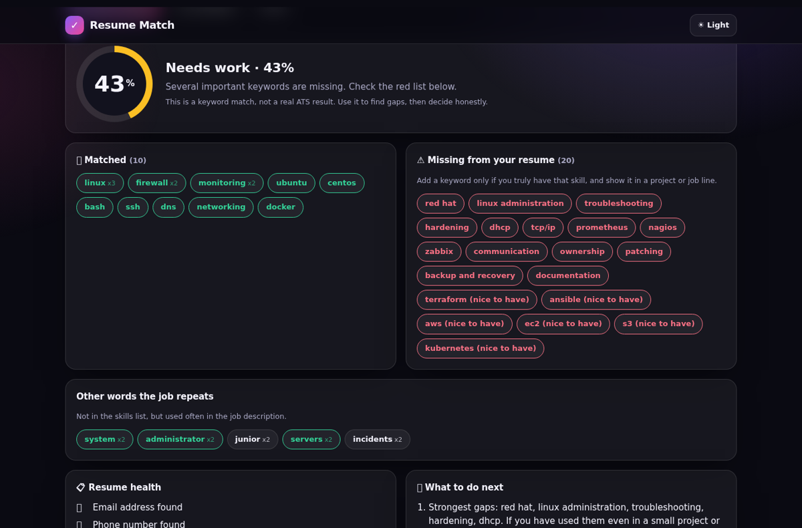
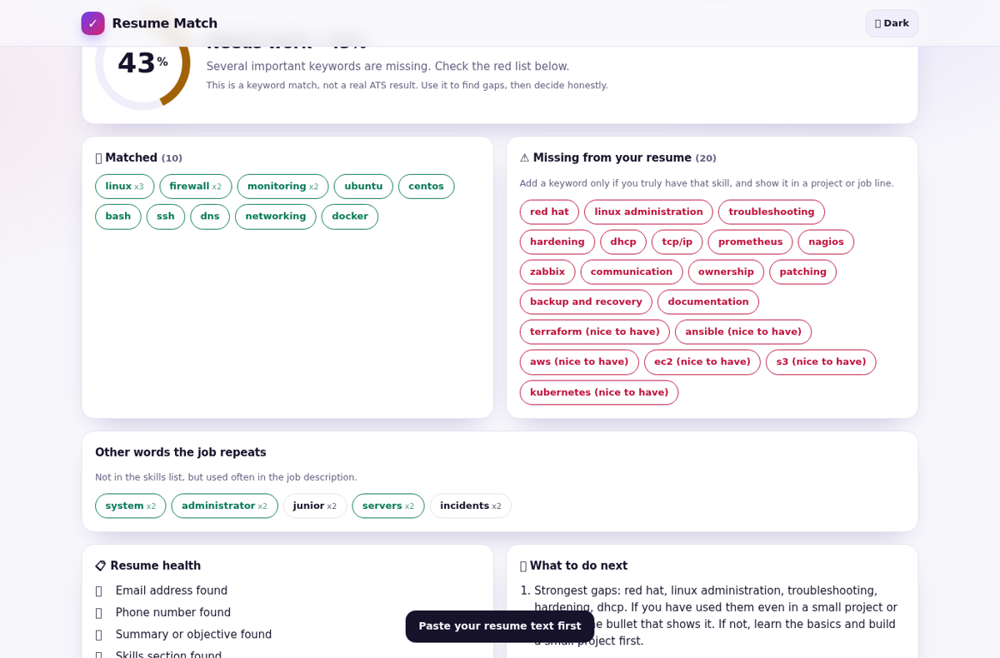
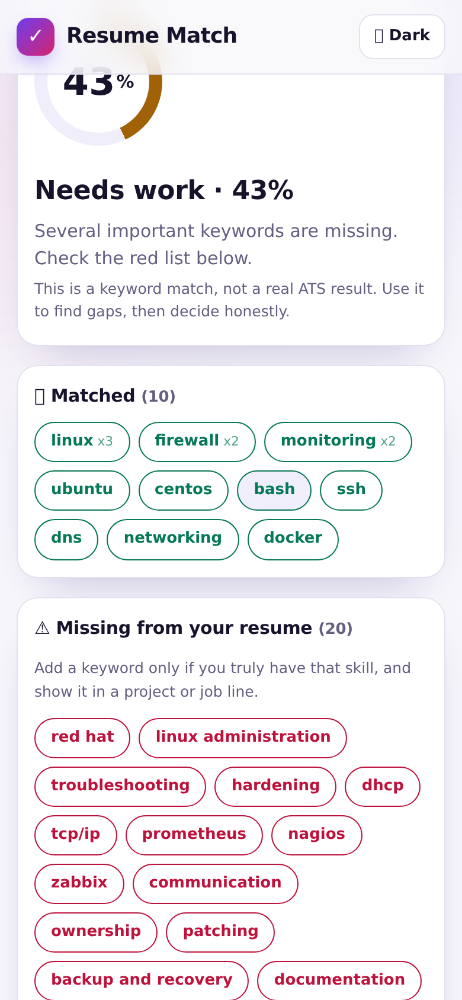

# Resume vs Job Description Match

Paste your resume and a job description. Get a keyword match score, matched and missing skills, resume health checks and simple next steps. Free and private.

## Screenshots





## Features

- Built-in list of about 300 IT and general skills with short forms (k8s, js, ci/cd, rhel...)
- Weights keywords by how often and how strongly the job asks (required vs nice to have)
- Shows matched, missing and other repeated words
- Resume health: contact info, sections, length, bullets, action verbs, numbers, links
- Job description shown with green and red highlights
- Sample data included (fictional)
- Nothing is uploaded or stored

## How to use

1. Paste your resume text and the job description.
2. Tap Check match.
3. Add missing keywords only where they are true for you.

## Honest limits

- Lite keyword matching, not a real ATS. Real systems differ.
- Reads plain text only. Copy text from your PDF or Word file.
- Synonyms are only covered through the built-in list.
- A high score does not guarantee a call.

## Tech and privacy

Plain HTML, CSS and JavaScript. No build step, no tracking, no backend. Everything runs in your browser. Nothing you type is uploaded. Installable as a PWA and works offline after the first visit.

## Run locally

```bash
git clone <this repo>
cd <folder>
python3 -m http.server 8000
# open http://localhost:8000
```

## Deploy free

GitHub Pages: Settings, Pages, Deploy from branch `main`, folder `/ (root)`.

## Author

Built by Akash Vishwakarma.
